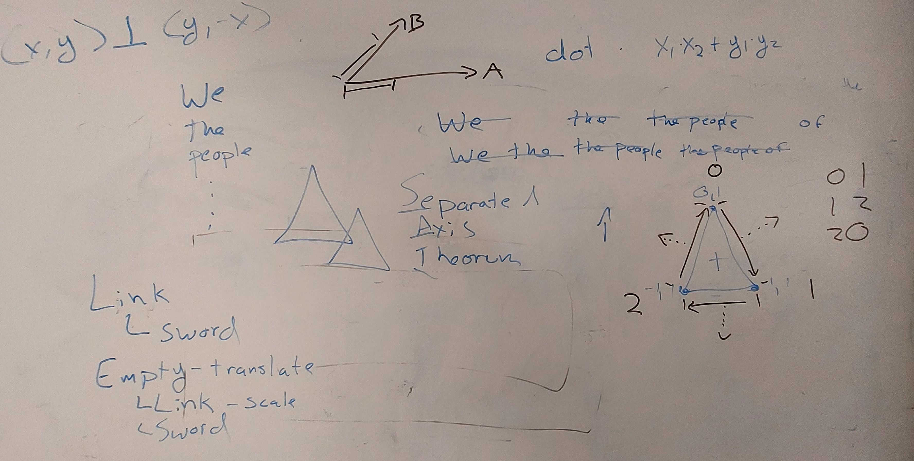
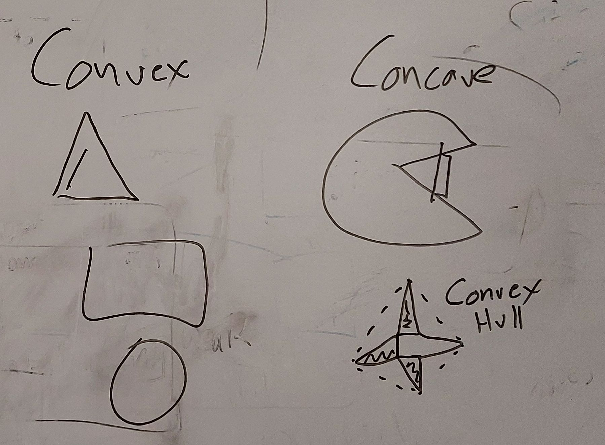
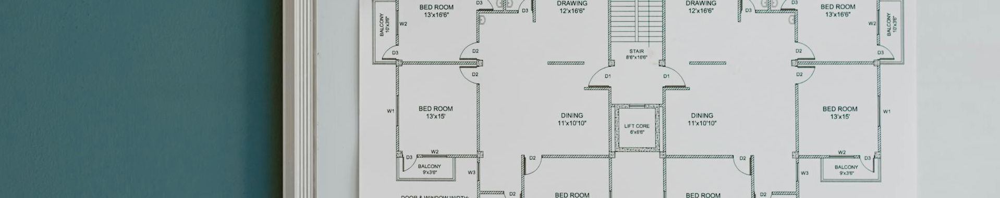

# CS 2510, Fall 2027, Topics
These are the topics we are going to cover in class each day. Links to [example student videos ](https://www.youtube.com/playlist?list=PLH9qo0GKu2iSlchbSeksN18S87gMIjHOg) 

# Day 20 - November 4 - Phiscs 3 (🧑‍🏫Lecture 13)

## Module: [fixedUpdate](./modules/Fixed%20Update.md)

## Module: [Detailed Collisions](./modules/Detailed%20Collisions.md)

## Module: [Platformer Dynamics](./modules/Platformer%20Dynamics.md)

# Day 19 - November 2  (👟Sprint 8)

## Topics covered briefly
- A website for comparing GitHub repos: https://bricks-teaching.github.io/differ/
- Fixed a bug that prevented onMouseOver from being called on UI game objects

  
  
---
---

# Day 18 - October 28 - Phiscs 1 (🧑‍🏫Lecture 12)

## New Idea: Newton's Laws of Motion
- Objects have velocity (that changes position)
- Objects have acceleration (what changes velocity)
- Equal and opposite reaction (object push against each other)

## New Idea: Overview: Collision Resolution and Minimum Transform Vector
- We need to resolve collisions by moving objects that overlap away from each other
- We want to move objects the minimum amount possible to resolve collisions
- The minimum amount and direction is called the *Minimum Transform Vector*
- The separate axis theorem, the process we use to find *if* objects are in collsion, can also give us the Minimum Transform Vector

## New Idea: Finding the Minimum Transform Vector
- Until now, our collision code only determine if polygons were in collision, not how much they were in collision
- While we loop over the "shadows" (projections onto the wall), we can keep track of the minimum amount of overlap we see and in what direction
- If we never find a gap in the projections, then we can calculate the minimum transform vector
  - The length of the vector is the minimum amount of overlap we saw
  - The direction of the vector is the direction of the axis used when projecting
- By returning this minimum transform vector instead of just `true`, we can do collision resolution

## New Idea: Collision Resolution
- When the Scene class is doing collision detection, it tracks which game objects have a rigid body component
- We store the two game objects in these kinds of collisions and their minimum transform vectors
- After send collision events, we loop over these collision and move the rigid bodies by the amount of teh minimum transform vectors
  - ...remembering to invert the minimum transform vector if the game object with the rigid body is listed second.
- Note that this satisfies Netwon's third law of motion

## New Idea: Top-Down Game
- With collision resolution, we can make a top-down game
- By adding a rigid body component to a game object, we indicate that it has collision resolution
- This game object will now stop when it runs into another game object that has a `Collider`
- If two game objects overlap and they both have `RigidBody` components, then they will push each other
- This process also produces wall sliding, but is apt to have ghost collisions (discussed later in class).

## New Idea: Rigid Body Dynamics
- In our rigid body component, we can add a velocity property
- In the rigid body's update function, we change the position by the velocity times `Time.deltaTime`
- We can also add acceleration, which we will call gravity.
- In the rigid body's update function, we change the velocity by gravity times `Time.delatTime`
- Note that this satisfies Netwon's first and second law of motion

## New Idea: Platformer Games
- We can make a platformer game once we have collision resolution and rigid body dynamics
- Create a player characters with a `Collider` and `RigidBody`
- Give that `RigidBody` gravity. 
  - Remember that games rarely use actually gravity values, especially if you are not using precise world units. 
  - Play around with this value until you get a value that works
- Create some platforms that have `Collider` components
- Your characters should land on these game objects but be able to free fall when not on these platforms.
- ⚠️ This implementation has problems because game objects continuously increase in velocity, even when they have landed on a platform
- In order to prevent a game object from slowly being sucked through a platform, we need to set its vertical velocity to 0 if it lands on a platform.
- In our `onCollisonStay` event, check to see if we are in collision with a platform that is below us and the minimum trantsform vector is pointing up. If so, set our vertical velocity to 0.

# Day 17 - October 26  (👟Sprint 7)

## Topics covered briefly
- "Diffing" code using open source tools, such as KDiff 3
  
  
---
---

# Day 16 - October 21 - Collisions 2 (🧑‍🏫Lecture 11)

# New Idea: Collisions Between Multiple Polygons
- Update the separate axis theorem to handle to polygons
- Each polygon is moved from model space to world space
- Each polygons is used to find edges
- Each polygon is project down each edge
- If there is a gap, there is not a collision
- If there is a gap, there is a collision.

# New Idea: Colliders
- We want the engine to keep track of collisions for game objects that have been "labeled" with a Collider component
  - We can use colliders to simplify hit boxes
- The engine will track anything that has a Collider component
- The engine will send events when there is a collision with the game objects in question
- Components can listen for these events to fire

# New Idea: Mouse Over Events
- The engine will report when the mouse is over a game object
- We need to move the mouse from screen space (pixels) into world space
- We invert the camera matrix and the matrix that moves the origin to the center of the screen
- We then report overlap
- Components can listen for these events to fire

# October 19 - No Class, University Holiday

# Day 15 - October 14 - Collisions 1 (🧑‍🏫Lecture 10)

# Multiline Text Label
- Break the text of the label down using `split`
- Add each word to the current line. 
- If the line is now too long, write the line without the word.

## 🖼️Activity:
- Look at collisions in a game: https://www.allsonicgames.net/sonic-the-hedgehog.php

## Module: [Vector Operations](./modules/Vector%20Operations.md)

## Module: [Separate Axis Theorem](./modules/Separate%20Axis%20Theorem.md)

  
---
---

# Day 14 - October 12  (👟Sprint 5)

## Topics covered briefly
- Mouse Move
- Text Height
  
  
---
---

# Day 13 - October 07 - Game Object Children and Mouse (🧑‍🏫Lecture 9)

## Module: [Game Object Hierarchies](./modules/Game%20Objects%20Hierarchies.md)

## Module: [Mouse Input](./modules/Mouse%20Input.md)

## 🧭Ideas to explore on your own
- How can you convert your game to use hierarchies?
- Why do many games use a combination of inputs, e.g. mouse and keyboard instead of just keyboard or mouse?

  
---
---

# Day 12 - October 5  (👟Sprint 4)

## Topics covered briefly
- Line wrapping in TextLabels (do it yourself)
- Scene background bug
- JSDoc so VS Code is helpful
- Scale/rotate bug (make sure your code is updated)
- Review AI policy
- Compare code (e.g. githubcompare.com)
- Negative scales produce a flip
- Transparency in colors
  
  
---
---

# Day 11 - September 30 - Cameras and Layers (🧑‍🏫Lecture 8)

## Module: [`broadcastMessage`](./modules/broadcastMessage.md)

## Module: [Layers](./modules/Layers.md)

## Module: [Cameras](./modules/Cameras.md)

## 💡New Idea: Scenes can have background colors
- This allows you to really differentiate start and stop scenes from the main game scenes
- The Camera component of the main camera stores the background color

# Day 10 - September 28  (👟Sprint 3)

[No additional topics covered]

  
---
---

# Day 09 - September 23 - SceneManager & Globals (🧑‍🏫Lecture 7)

## Module: [`SceneManager`](./modules/SceneManager.md)

## Module: [`Globals`](./modules/Globals.md)

- Level Controllers

## 💡New Idea: Search game objects by attributes (tags)
- Unity doesn't allow you to search for multiple game objects by name
- Instead, we give game objects "tags", or a list of string attributes
- This allows us to look for all game objects that are tagged as enemies or UI
- The function we add is `GameObject.findGameObjectsWithTag`
  

  
---
---

# Day 08 - September 21  (👟Sprint 2)

## Module: [`getComponent`](./modules/GetComponent.md)

## Module: [`TextLabel`](./modules/TextLabel.md)

  
---
---

# Day 07 - September 16 - Communication Basics (🧑‍🏫Lecture 6)

Add scale and rotate to transforms. See the [Module on Transforms](./modules/Transform%20-%20Basics.md)

## Activity: Add an enemy ship to our game
- Our ship has the same shape as our player ship
  - We can save time by creating an asset and reusing it
  - We can save time by rotating the ship asset for the enemy ship

## Module: [Time.deltaTime](./modules/Time.deltaTime.md)

## Module: [GameObject.name](./modules/GameObject.name.md)

## Module: [Communication - GameObject.find](./modules/Communication%20-%20GameObject.find.md)

## Module: [Basic Collisions](./modules/Basic%20Collisions.md)

  
---
---

# Day 06 - September 14  (👟Sprint 1)

## Module: [Game Object Lifecycle - Destroy](./modules/Game%20Object%20Lifecycle%20-%20Destroy.md)

  
---
---

# Day 05 - September 9 - Engine-Level Components (🧑‍🏫Lecture 5)

## Module: [Transform - Basics](./modules/Transform%20-%20Basics.md)

## Module: [Instantiate](./modules/Instantiate.md)

## Module: [Polygon Component](./modules/Polygon%20Component.md)

## Module: [Customizable Components](./modules/Customizable%20Components.md)

## Activity: Look for Scenes, Game Objects, and Components
- Look at a video about a game and look for scenes, game objects, and components

  
---
---

# Day 04 - September 2 - Standard Architecture for Games (🧑‍🏫Lecture 4)

## 📢Announcements
- Upcoming sprint expectations
  - You can [study JS](https://javascript.info) as part of your sprint
  - You can plan the scenes, game objects, and components in your game. Just make sure you can show it to us during the sprint.
  - You can review/finish transcribing the engine. You can go through and add comments to help you understand the concepts.
  - Otherwise, work on your engine and game

## Module: [Standard Architecture for Games](./modules/Standard%20Architecture%20for%20Games.md)

  
---
---

# Day 03 - August 31 - Engines and Keyboard Input (🧑‍🏫Lecture 3)

## 🔙Review
- What is a game loop?
- What is a vector?

## Module: [Intro to Game Engines](./modules/Intro%20to%20Game%20Engines.md)

## Module: [Intro to Keyboard Input](./modules/Intro%20to%20Keyboard%20Input.md)

  
---
---

# Day 02 - August 26 - Game Loop (🧑‍🏫Lecture 2)

## 📺 Video Summary
- Many of the topics from this lecture can be found in [this video about game loops](https://www.youtube.com/watch?v=zIxjCk4BCHE)

## 🔙Review
- What is the difference between the Box Model, SVG, and Canvas?
- What is the difference between the JS keyword `let` and `const`?

## Syllabus Review

## 💡New Idea: What is a computer game? (Review from previous day)
- In this class, a game is an enjoyable, interactive, visual simulation.
- How are we going to learn game programming?
  - Learn the math
  - Learn the architecture
  - Practice

## Module: [Introduction to Game Loop](./modules/Intro%20to%20Game%20Loop.md)

## Module: [Introduction to Vectors](./modules/Introduction%20to%20Vectors.md)

## Module: [Classes in Javascript](./modules/Classes%20in%20Javascript.md)

## 👩‍💻Activity
- Create a simple moving game object simulation using the new Vector2 class. 

## 🤔To Think About
- Why is creative mode in Minecraft considered a game while a painting app is not?

## Ideas to explore on your own
- Can you make the code use arrays so that you don't need to manually call `lineTo` for each vertex?

  
---
---

# Day 01 - August 24 - Introduction (🧑‍🏫Lecture 1)

## 📺 Video Summary
- Many of the topics from this lecture can be found in [this video about game loops](https://www.youtube.com/watch?v=zIxjCk4BCHE)

## 📢Announcements
- Welcome to class
- Get a GitHub account

## Module: [Game Programming Courses](./modules/Game%20Programming%20Courses.md)

## 🎉Course Goals
- We are going to build a 2D game engine and game in [JavaScript](javascript.info)
- So we can focus on programming, not gathering assets, our games in this class will not include:
  - Images (Including emoji)
  - Sounds
- I will be using the [VS Code IDE](https://code.visualstudio.com/) in class, but you can use any IDE
- I will be using the [Live Server](https://marketplace.visualstudio.com/items?itemName=ritwickdey.LiveServer) in VS Code, but you don't have to.
- You can see some [examples of what previous students have done on YouTube](https://www.youtube.com/playlist?list=PLH9qo0GKu2iSlchbSeksN18S87gMIjHOg)
  
## Module: [Drawing in HTML](./modules/Drawing%20in%20HTML.md)

## Module: [Intro to JavaScript](./modules/Intro%20to%20Javascript.md)

## Module: [Drawing to a Canvas](./modules/Drawing%20on%20a%20Canvas.md)
  

